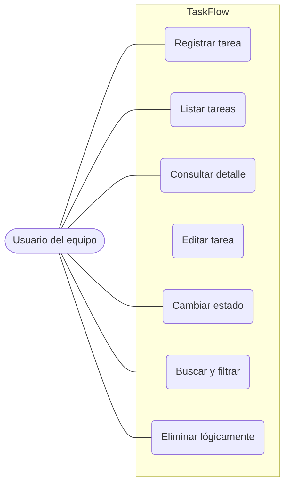
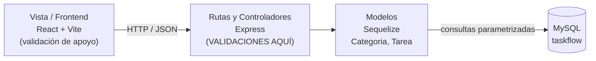

# ANALISIS - TaskFlow

## 1. Problema y alcance
Las tareas de un equipo se anotan en mensajes y hojas de cálculo, por lo que
se pierden y no se conoce su estado. TaskFlow es un módulo web pequeño para
registrar, consultar, actualizar y controlar tareas.

Alcance: módulo de tareas. Las categorías se consultan desde la base de datos.

## 2. Actor principal
**Usuario del equipo**: registra y da seguimiento a las tareas.

## 3. Requerimientos funcionales
| ID | Requerimiento |
|----|---------------|
| RF-01 | Listar tareas activas (código, categoría, responsable, prioridad, estado, fecha). |
| RF-02 | Registrar una tarea eligiendo una categoría existente. |
| RF-03 | Consultar una tarea por su identificador. |
| RF-04 | Editar los datos descriptivos de una tarea. |
| RF-05 | Cambiar el estado respetando el flujo permitido. |
| RF-06 | Eliminación lógica (activo = false), sin borrado físico. |
| RF-07 | Buscar por código, responsable o nombre de categoría. |
| RF-08 | Filtrar por prioridad, estado y categoría. |
| RF-09 | Mostrar mensajes claros de éxito, validación y error. |
| RF-10 | Mantener los datos en MySQL tras cerrar o recargar la aplicación. |

## 4. Reglas de negocio
| Campo / regla | Condición |
|---------------|-----------|
| Categoría | Debe existir en la tabla categoria. |
| Responsable | Obligatorio, mínimo 3 caracteres sin espacios externos. |
| Descripción | Obligatoria, mínimo 10 caracteres sin espacios externos. |
| Prioridad | Solo BAJA, MEDIA o ALTA. |
| Estado inicial | Toda tarea nueva inicia en PENDIENTE. |
| Código | Automático y único. Formato: TAR-AAAAMMDD-XXX. |
| Transición 1 | PENDIENTE pasa a EN_PROCESO o CANCELADA. |
| Transición 2 | EN_PROCESO pasa a COMPLETADA o CANCELADA. |
| Estados finales | COMPLETADA y CANCELADA no pueden cambiar de estado. |
| Eliminación lógica | Se cambia activo a false y se excluye del listado normal. |
| Edición | No puede cambiar id, código ni fecha de registro. |

Todas las validaciones se ejecutan en el backend. El frontend las repite solo
para mejorar la experiencia de uso.

## 5. Diagrama UML de casos de uso

## 6. Esquema de arquitectura MVC/API

Las validaciones de negocio (campos, prioridad, transiciones de estado) se
ejecutan en los **controladores** del backend, porque es la capa que protege
la integridad de los datos aunque el cliente envíe datos incorrectos.